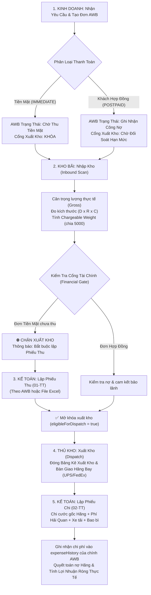
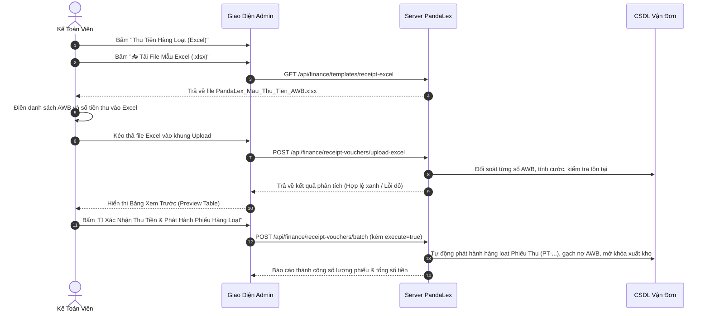

# TÀI LIỆU HƯỚNG DẪN SỬ DỤNG HỆ THỐNG PANDALEX EXPRESS
**Hệ Thống Quản Trị Vận Tải Quốc Tế & Tài Chính Logistics (TMS & Finance Enterprise)**

---

## MỤC LỤC
1. [GIỚI THIỆU TỔNG QUAN & ĐĂNG NHẬP HỆ THỐNG](#1-giới-thiệu-tổng-quan--đăng-nhập-hệ-thống)
2. [SƠ ĐỒ QUY TRÌNH VẬN HÀNH KHÉP KÍN TOÀN CÔNG TY](#2-sơ-đồ-quy-trình-vận-hành-khép-kín-toàn-công-ty)
3. [PHÂN HỆ DÀNH CHO NHÂN VIÊN KINH DOANH & ĐIỀU HÀNH (SALES / DISPATCHER)](#3-phân-hệ-dành-cho-nhân-viên-kinh-doanh--điều-hành-sales--dispatcher)
   - 3.1. Tra Cứu Giá Cước & Phụ Phí Vận Chuyển
   - 3.2. Tạo Đơn Vận Chuyển Quốc Tế (Tạo AWB)
   - 3.3. Phân Loại Luồng Thanh Toán (Tiền Mặt vs Khách Hợp Đồng)
   - 3.4. Xuất Nhãn Vận Đơn (AWB Label) & Hóa Đơn Thương Mại (Commercial Invoice)
4. [PHÂN HỆ DÀNH CHO THỦ KHO & VẬN HÀNH KHO BÃI (WAREHOUSE)](#4-phân-hệ-dành-cho-thủ-kho--vận-hành-kho-bãi-warehouse)
   - 4.1. Quy Trình Nhập Kho (Inbound Scan) & Cân Đo Kiện Hàng
   - 4.2. Cổng Kiểm Soát Tài Chính (Financial Gate) & Chặn Xuất Kho
   - 4.3. Xuất Kho (Outbound Dispatch) & Lập Bảng Kê Bàn Giao Hãng
5. [PHÂN HỆ DÀNH CHO KẾ TOÁN & QUẢN LÝ TÀI CHÍNH (FINANCE & ACCOUNTING)](#5-phân-hệ-dành-cho-kế-toán--quản-lý-tài-chính-finance--accounting)
   - 5.1. Nguyên Tắc Cốt Lõi: Mọi Khoản Thu & Chi Bắt Buộc Gắn Liền Với Mã AWB
   - 5.2. Lập Phiếu Thu Tiền Đơn Lẻ (Mẫu 01-TT)
   - 5.3. Thu Tiền Hàng Loạt Bằng File Excel (.xlsx)
   - 5.4. Lập Phiếu Chi Tiền Đơn Lẻ (Mẫu 02-TT) & Ghi Nhận Chi Phí AWB
   - 5.5. Chi Phí Hàng Loạt Bằng File Excel (.xlsx)
   - 5.6. Quản Lý Danh Mục Khoản Thu & Khoản Chi
   - 5.7. Quản Lý Sổ Quỹ Thu - Chi Toàn Diện (Cash Book Ledger)
   - 5.8. Quản Lý Ký Quỹ Hãng Bay & Nạp Ví Đại Lý
6. [PHÂN HỆ QUẢN LÝ KHÁCH HÀNG & CÔNG NỢ ĐẠI LÝ](#6-phân-hệ-quản-lý-khách-hàng--công-nợ-đại-lý)
7. [QUẢN TRỊ HỆ THỐNG, BIỂU CƯỚC & PHÂN QUYỀN](#7-quản-trị-hệ-thống-biểu-cước--phân-quyền)
8. [CÂU HỎI THƯỜNG GẶP (FAQ) & XỬ LÝ SỰ CỐ](#8-câu-hỏi-thường-gặp-faq--xử-lý-sự-cố)

---

## 1. GIỚI THIỆU TỔNG QUAN & ĐĂNG NHẬP HỆ THỐNG

### 1.1. Giới thiệu PandaLex Express
**PandaLex Express** là hệ thống quản trị vận tải quốc tế chuyên nghiệp (TMS - Transportation Management System), tích hợp chặt chẽ giữa:
- **Nghiệp vụ Chuyển Phát Nhanh Quốc Tế**: Kết nối trực tiếp dịch vụ chuyển phát nhanh UPS, FedEx, DHL; tự động áp biểu cước, tính phụ phí xăng dầu (Fuel Surcharge), tính trọng lượng thể tích IATA.
- **Vận Hành Kho 3 Chi Nhánh**: Hà Nội (`HAN`), TP. Hồ Chí Minh (`SGN`), Đà Nẵng (`DAD`).
- **Kiểm Soát Tài Chính Nghiêm Ngặt**: Kiểm soát luồng tiền mặt tại quầy, quản lý công nợ khách hàng hợp đồng, và hạch toán chi phí chi tiết theo từng số Vận Đơn (AWB).

### 1.2. Đăng nhập hệ thống
1. Truy cập địa chỉ website: `https://vanchuyenquocte.online/admin.html` (hoặc cổng nội bộ `http://localhost:4000/admin.html`).
2. Nhập tài khoản và mật khẩu được cấp:
   - **Tài khoản Quản trị**: `admin` / Mật khẩu: `admin@123`
   - **Tài khoản Kế toán**: `ketoan` / Mật khẩu: `ketoan@123`
   - **Tài khoản Kho bãi**: `kho_sgn` hoặc `kho_han` / Mật khẩu: `kho@123`
3. Chọn chi nhánh làm việc mặc định (`SGN`, `HAN` hoặc `DAD`).
4. Bấm **Đăng Nhập**. Hệ thống được trang bị cơ chế bảo mật JWT Auth Guard, tự động ngăn chặn truy cập trái phép.

---

## 2. SƠ ĐỒ QUY TRÌNH VẬN HÀNH KHÉP KÍN TOÀN CÔNG TY

---

## 3. PHÂN HỆ DÀNH CHO NHÂN VIÊN KINH DOANH & ĐIỀU HÀNH (SALES / DISPATCHER)

### 3.1. Tra Cứu Giá Cước & Phụ Phí Vận Chuyển
1. Truy cập menu **Biểu Cước & Định Giá** hoặc trang tính cước nhanh `calculator.html`.
2. Chọn hãng vận chuyển: **UPS** hoặc **FedEx**.
3. Chọn quốc gia đến (VD: Hoa Kỳ `US`, Úc `AU`, Canada `CA`, Nhật Bản `JP`...).
4. Nhập trọng lượng (kg) và kích thước kiện hàng (Dài x Rộng x Cao cm).
5. Hệ thống tự động:
   - Quy đổi trọng lượng thể tích: $\text{Trọng lượng thể tích (kg)} = \frac{\text{Dài} \times \text{Rộng} \times \text{Cao}}{5000}$.
   - Lấy giá trị lớn hơn giữa Trọng lượng thực tế và Trọng lượng thể tích để làm **Trọng lượng tính cước (Chargeable Weight)**.
   - Nhân bảng cước theo Vùng (Zone) và cộng phụ phí xăng dầu thời gian thực.
   - Hiển thị cả **Giá Gốc Mua Hãng (Cost Price)** và **Giá Bán Khách Hàng (Sell Price)** cùng lợi nhuận gộp dự kiến.

### 3.2. Tạo Đơn Vận Chuyển Mới (Tạo AWB)
1. Bấm nút **`+ Tạo Đơn Vận Chuyển Mới`**.
2. Điền thông tin Người gửi (Shipper): Tên công ty, người gửi, số điện thoại, địa chỉ kho tại Việt Nam.
3. Điền thông tin Người nhận (Consignee): Tên, số điện thoại, địa chỉ chi tiết, Thành phố, Bang/Tỉnh, Mã bưu chính (Postal Code), Quốc gia.
4. Chọn Hãng vận chuyển:
   - **UPS**: UPS Worldwide Saver (Express), UPS Expedited...
   - **FedEx**: FedEx International Priority (IP), FedEx International Economy (IE)...
5. Nhập chi tiết danh mục hàng hóa (Mô tả hàng, số lượng, đơn giá USD để phục vụ thông quan hải quan).

### 3.3. Phân Loại Luồng Thanh Toán (Cực Kỳ Quan Trọng)
Hệ thống yêu cầu chọn đúng 1 trong 2 luồng tài chính:
- **1. Thanh Toán Ngay / Tiền Mặt (`IMMEDIATE`)**: Dành cho khách lẻ, khách vãng lai, khách trả tiền mặt tại bưu cục hoặc chuyển khoản ngay khi gửi.
  > [!IMPORTANT]
  > Đơn hàng chọn hình thức này sẽ bị **KHÓA XUẤT KHO** tự động. Bắt buộc kế toán phải phát hành **Phiếu Thu Tiền Mặt (01-TT)** thì thủ kho mới được phép cho hàng bay!
- **2. Thanh Toán Sau / Khách Hàng Hợp Đồng (`POSTPAID`)**: Dành cho các công ty, đại lý có hợp đồng vận chuyển nguyên tắc và thỏa thuận công nợ định kỳ (chu kỳ 7 ngày, 15 ngày hoặc 30 ngày). Cước bán sẽ tự động ghi nợ vào sổ công nợ của khách hàng.

### 3.4. Xuất Nhãn Vận Đơn (AWB Label) & Hóa Đơn Thương Mại (Commercial Invoice)
- Sau khi bấm Lưu Đơn Hàng, hệ thống sẽ cấp Mã Vận Đơn chính thức (Ví dụ mã UPS: `1Z861R320493609873`).
- Bấm nút **In Tem AWB**: In nhãn nhiệt 4x6 inch (10x15 cm) dán trực tiếp lên kiện hàng.
- Bấm nút **In Invoice** hoặc **Tải Invoice Excel**: Tự động xuất file Commercial Invoice chuẩn hải quan có đầy đủ thông tin gửi nhận, khai báo giá trị và điều khoản vận chuyển quốc tế.

---

## 4. PHÂN HỆ DÀNH CHO THỦ KHO & VẬN HÀNH KHO BÃI (WAREHOUSE)

### 4.1. Quy Trình Nhập Kho (Inbound Scan)
Khi kiện hàng được xe gom hàng đưa về bưu cục/kho:
1. Thủ kho mở tab **Quản Lý Kho Hàng & Nhập Kho**.
2. Dùng máy quét mã vạch (Barcode Scanner) quét mã vận đơn AWB dán trên kiện.
3. Đặt kiện hàng lên cân điện tử: Nhập **Trọng lượng thực tế (Gross Weight)**.
4. Đo 3 chiều kiện hàng: Nhập **Dài x Rộng x Cao (cm)**.
5. Bấm **Xác Nhận Nhập Kho**: Hệ thống tự động ghi nhận thời gian `inboundedAt`, thủ kho thực hiện `inboundedBy`, và chi nhánh Hub tiếp nhận.

### 4.2. Cổng Kiểm Soát Tài Chính (Financial Gate) & Chặn Xuất Kho
Hệ thống áp dụng cơ chế 3 lớp bảo vệ để chống thất thoát cước vận chuyển:
- **Điều kiện 1 (`isPaid`)**: Đối với đơn tiền mặt, phải có Phiếu Thu tiền mặt chính thức từ kế toán.
- **Điều kiện 2 (`isCustomerCommitted`)**: Đối với đơn hợp đồng, khách hàng chưa vượt quá hạn mức công nợ tối đa cho phép.
- **Điều kiện 3 (`isDeducted`)**: Đối với đơn trừ ví đại lý, số dư ví phải đủ và đã được trừ tiền thành công.

> [!CAUTION]
> Khi thiếu bất kỳ điều kiện nào, trạng thái của đơn sẽ hiển thị màu đỏ: **`⛔ CHƯA ĐỦ ĐIỀU KIỆN XUẤT KHO (ELIGIBLE = FALSE)`**.
> Nút xuất kho của đơn hàng đó sẽ bị vô hiệu hóa hoàn toàn, ngăn chặn tuyệt đối tình trạng cho hàng bay trước mà chưa thu được tiền.

### 4.3. Xuất Kho (Outbound Dispatch) & Lập Bảng Kê Bàn Giao
Khi đơn hàng đã chuyển sang trạng thái xanh **`Đủ Điều Kiện Xuất Kho (ELIGIBLE = TRUE)`**:
1. Chọn danh sách các vận đơn cần xuất bay trong ca.
2. Bấm nút **Tạo Bảng Kê Xuất Kho (Dispatch Manifest)**.
3. Hệ thống sinh mã Bảng kê xuất kho (Ví dụ: `BK-HAN-20261013-001`).
4. In Bảng kê bàn giao ra 2 liên:
   - 01 liên giao cho tài xế hãng bay (UPS / FedEx) ký nhận.
   - 01 liên lưu kho bãi để đối soát.
5. Trạng thái vận đơn tự động chuyển sang: **`DISPATCHED - Đã Xuất Kho Giao Hãng Bay`**.

---

## 5. PHÂN HỆ DÀNH CHO KẾ TOÁN & QUẢN LÝ TÀI CHÍNH (FINANCE & ACCOUNTING)

Đây là phân hệ trung tâm đảm bảo minh bạch, chính xác từng đồng doanh thu và chi phí của công ty.

### 5.1. Nguyên Tắc Cốt Lõi Của Hệ Thống
> [!IMPORTANT]
> **TẤT CẢ CÁC KHOẢN THU VÀ CHI TRONG PANDALEX ĐỀU PHẢI GẮN LIỀN VỚI SỐ VẬN ĐƠN (AWB).**
> - Không được phép lập phiếu thu hoặc phiếu chi trống không có số AWB.
> - Số AWB phải tồn tại trong cơ sở dữ liệu hệ thống.
> - Mỗi đồng tiền thu về phải gạch nợ cho đúng AWB và đúng khách hàng.
> - Mỗi đồng tiền chi ra (mua cước hãng, hải quan, xe tải, bao bì) phải gắn trực tiếp vào lịch sử chi phí của đúng AWB đó.

### 5.2. Lập Phiếu Thu Tiền Đơn Lẻ (Mẫu 01-TT)
Sử dụng khi khách hàng nộp tiền mặt tại quầy hoặc chuyển khoản trực tiếp cho từng đơn hàng.
1. Trong menu **Tài Chính & Sổ Quỹ**, bấm **`+ Lập Phiếu Thu Tiền`**.
2. **Nhập Mã Vận Đơn (AWB) \***: Nhập số AWB (VD: `1Z861R320493609873`) rồi bấm **Tra Cứu** (hoặc nhấn phím `Enter`).
3. Hệ thống sẽ tự động điền:
   - Số tiền cước bán.
   - Tên khách hàng / Đại lý.
   - Số điện thoại người nộp.
   - Chi nhánh Hub thu tiền.
   - Diễn giải thu tiền cước kèm thông tin hãng và quốc gia đến.
4. Chọn **Kênh Thanh Toán**:
   - `💵 Tiền mặt tại quầy / quỹ`
   - `🏦 Chuyển khoản Vietcombank / Techcombank...`
   - `💳 Khấu trừ ví tài khoản`
   - `💳 Cà thẻ POS ngân hàng`
5. Chọn hành động:
   - Bấm **`Lưu Phiếu Thu`**: Hệ thống cấp mã phiếu thu `PT-YYYYMMDD-XXXX`, cập nhật sổ quỹ, và **mở khóa xuất kho ngay lập tức**.
   - Bấm **`Lưu & In Ngay (01-TT)`**: Lưu phiếu và mở ngay bản in Phiếu Thu chuẩn Thông tư 200/2014/TT-BTC với đầy đủ thông tin Người nộp, Địa chỉ, Số tiền bằng chữ, kèm 4 chữ ký (Giám đốc, Kế toán trưởng, Người nộp tiền, Thủ quỹ).

---

### 5.3. Thu Tiền Hàng Loạt Bằng File Excel (.xlsx)
Quy chuẩn chuẩn hóa: **Tải File Mẫu -> Điền Dữ Liệu -> Upload File Excel Lên Hệ Thống -> Xem Preview Đối Soát -> Bấm Xác Nhận Thu**.

#### Các bước thực hiện chi tiết:
1. Bấm nút **`📥 Thu Tiền Theo Excel`**.
2. Bấm nút **`📥 Tải File Mẫu Excel (.xlsx)`** để tải mẫu chuẩn về máy tính.
3. Mở file Excel và nhập các cột:
   - `STT`: Số thứ tự (1, 2, 3...)
   - `Mã Vận Đơn (AWB) *`: Bắt buộc điền đúng mã vận đơn (Ví dụ: `1Z861R320493609873`).
   - `Số Tiền Thu (VNĐ) *`: Số tiền thu (Nếu để trống, hệ thống sẽ tự động lấy cước bán trong hệ thống).
   - `Hình Thức Thanh Toán`: Điền `TIEN_MAT` hoặc `CHUYEN_KHOAN`.
   - `Người Nộp Tiền`: Họ tên khách hàng hoặc tên công ty nộp tiền.
   - `Lý Do Thu / Ghi Chú`: Diễn giải chi tiết.
4. Kéo thả file Excel vừa điền vào khung nét đứt màu xanh: **"Nhấp để chọn file Excel hoặc kéo thả file vào đây"**.
5. Hệ thống lập tức đọc file và hiển thị **Bảng Xem Trước Đối Soát (Preview Table)**:
   - Dòng có mã AWB hợp lệ: Hiển thị nhãn xanh **`✅ Hợp lệ`**, hiện rõ tên khách hàng, cước bán và kênh thanh toán.
   - Dòng có lỗi: Hiển thị nhãn đỏ **`❌ AWB không tồn tại trên hệ thống`** hoặc **`Thiếu mã AWB`**.
   - Thanh thống kê hiển thị: `✅ Hợp lệ: X dòng • ❌ Lỗi: Y dòng • Tổng thu: Z VNĐ`.
6. Bấm nút **`🚀 Xác Nhận Thu Tiền & Phát Hành Phiếu Hàng Loạt`**:
   - Hệ thống tự động tạo hàng loạt Phiếu Thu chính thức.
   - Gạch nợ từng đơn hàng và mở khóa xuất kho cho tất cả các đơn tiền mặt hợp lệ.
   - Tự động cộng tiền vào Sổ Quỹ Thu - Chi.

---

### 5.4. Lập Phiếu Chi Tiền Đơn Lẻ (Mẫu 02-TT) & Ghi Nhận Chi Phí AWB
Sử dụng khi chi tiền cước gốc trả hãng bay, chi hải quan, chi xe tải lấy hàng, chi mua thùng carton...
1. Bấm nút **`+ Lập Phiếu Chi Tiền`**.
2. **Nhập Mã Vận Đơn (AWB) \***: Nhập số AWB liên quan đến chi phí rồi bấm **Tra Cứu**.
3. Hệ thống tự động điền:
   - Giá vốn cước gốc (Cost Price).
   - Đơn vị nhận tiền: Tự động điền theo hãng của AWB (VD: `UPS Express Worldwide` hoặc `FedEx Express VN`).
   - Khoản mục chi: Tự động chọn `EXP_CARRIER_COST - Chi cước gốc mua hãng bay`.
4. Trường hợp chi các chi phí khác cho AWB đó, kế toán chọn lại danh mục chi:
   - `EXP_CUSTOMS_CLEARANCE`: Phí kiểm hóa và thông quan hải quan.
   - `EXP_FIRST_MILE_TRUCKING`: Phí xe tải trung chuyển lấy hàng nội địa.
   - `EXP_PACKAGING_SUPPLIES`: Mua vật tư đóng gói (Thùng carton, màng PE, băng dính).
   - `EXP_SHIPMENT_COMPENSATION`: Bồi thường hư hỏng, thất lạc hàng hóa.
5. Chọn phương thức chi: `💵 Tiền mặt tại quỹ` hoặc `🏦 Ủy nhiệm chi ngân hàng`.
6. Bấm **`Lưu Phiếu Chi`** hoặc **`Lưu & In Ngay (02-TT)`**:
   - Khoản chi được ghi nhận tức thì vào lịch sử chi phí `expenseHistory` của chính AWB.
   - Nếu là chi cước gốc hãng (`EXP_CARRIER_COST`), AWB được đánh dấu đã quyết toán nợ hãng (`vendorSettled = true`).
   - In Phiếu Chi chuẩn Mẫu 02-TT theo Thông tư 200/2014/TT-BTC.

---

### 5.5. Chi Phí Hàng Loạt Bằng File Excel (.xlsx)
1. Bấm nút **`📤 Chi Tiền Theo Excel`**.
2. Bấm nút **`📥 Tải File Mẫu Excel Chi Phí (.xlsx)`**.
3. Điền các cột:
   - `Mã Vận Đơn (AWB) *`: Bắt buộc có mã AWB.
   - `Mã Khoản Mục Chi *`: Điền `EXP_CARRIER_COST`, `EXP_CUSTOMS_CLEARANCE`, `EXP_FIRST_MILE_TRUCKING`, `EXP_PACKAGING_SUPPLIES`...
   - `Số Tiền Chi (VNĐ) *`: Số tiền thực chi.
   - `Người / Đơn Vị Nhận *`: Tên hãng bay hoặc nhà cung cấp nhận tiền.
   - `Hình Thức Chi`: `TIEN_MAT` hoặc `CHUYEN_KHOAN`.
   - `Lý Do Chi Phí`: Diễn giải.
4. Kéo thả file Excel vào khung tải file.
5. Xem trước bảng đối soát: Kiểm tra tính hợp lệ của từng dòng AWB.
6. Bấm **`🚀 Xác Nhận Chi Tiền & Phát Hành Phiếu Hàng Loạt`**:
   - Hệ thống tự động sinh các Phiếu Chi `PC-YYYYMMDD-XXXX`.
   - Ghi nhận chi phí trực tiếp vào từng đơn hàng và khấu trừ vào Sổ Quỹ.

---

### 5.6. Quản Lý Danh Mục Khoản Thu & Khoản Chi
1. Bấm nút **`📂 Quản Lý Danh Mục Thu / Chi`**.
2. Xem danh sách danh mục thu và chi mặc định của hệ thống.
3. Kế toán có thể bấm **`+ Thêm Danh Mục Mới`**:
   - Nhập Mã danh mục (VD: `EXP_WAREHOUSE_RENT`).
   - Nhập Tên danh mục (VD: `Chi phí thuê kho bãi chi nhánh`).
   - Chọn phân loại: **Doanh Thu (REVENUE)** hoặc **Chi Phí (EXPENSE)**.
   - Nhập mô tả diễn giải.
4. Bấm **Lưu Danh Mục**. Danh mục mới sẽ xuất hiện ngay trong tất cả các màn hình lập phiếu thu/chi và bộ lọc sổ quỹ.

---

### 5.7. Quản Lý Sổ Quỹ Thu - Chi Toàn Diện (Cash Book Ledger)
1. Truy cập tab **Sổ Quỹ Thu - Chi (Cash Book)**.
2. Thẻ chỉ số tổng quan ở đầu trang cập nhật liên tục:
   - **Tổng Thu Trong Kỳ**: Toàn bộ tiền cước và phụ phí đã thu thực tế.
   - **Tổng Chi Trong Kỳ**: Toàn bộ cước gốc hãng và chi phí vận hành đã chi.
   - **Tồn Quỹ Thực Tế**: Hiển thị rõ Tồn quỹ Tiền Mặt tại két và Tồn quỹ Ngân Hàng.
   - **Lợi Nhuận Gộp Ước Tính**: Chênh lệch giữa Doanh thu và Chi phí phát sinh.
3. Bộ lọc chuyên sâu:
   - Lọc theo Loại phiếu: `Tất cả` / `Phiếu Thu (PT)` / `Phiếu Chi (PC)`.
   - Lọc theo Phương thức: `Tiền mặt` / `Ngân hàng`.
   - Lọc theo Chi nhánh Hub: `SGN` / `HAN` / `DAD`.
   - Lọc theo Khoảng thời gian: Từ ngày đến ngày.
   - Tìm kiếm nhanh theo Số Phiếu, Số AWB, Tên khách hàng.
4. Mỗi dòng giao dịch đều có nút **In Phiếu (01-TT / 02-TT)** để in lại bất cứ lúc nào.

---

### 5.8. Quản Lý Ký Quỹ Hãng Bay & Nạp Ví Đại Lý
- **Ký Quỹ Tài Khoản Hãng (Carrier Deposit)**:
  - Quản lý số dư hạn mức nạp trước cho các tài khoản UPS, FedEx, DHL của công ty.
  - Khi số dư ký quỹ xuống dưới mức cảnh báo (dưới 10.000.000 đ), hệ thống sẽ cảnh báo đỏ để kế toán kịp thời nộp thêm tiền tránh bị hãng khóa tài khoản bay.
- **Nạp Ví Đại Lý (Agent Wallet Top-up)**:
  - Cho phép các đại lý cấp 2 nạp tiền trước vào ví.
  - Khi đại lý tạo đơn, hệ thống tự động trừ tiền trong ví đại lý.

---

## 6. PHÂN HỆ QUẢN LÝ KHÁCH HÀNG & CÔNG NỢ ĐẠI LÝ

1. Truy cập tab **Khách Hàng & Công Nợ**.
2. Danh sách khách hàng hiển thị: Mã khách hàng, Tên doanh nghiệp, Số điện thoại, Hạn mức tín dụng nợ cho phép, Tổng nợ lũy kế hiện tại.
3. Xem chi tiết công nợ từng khách hàng:
   - Danh sách các AWB chưa thanh toán.
   - Số ngày quá hạn thanh toán.
   - Lịch sử các lần gạch nợ từ Phiếu Thu của kế toán.
4. Xuất Báo Cáo Công Nợ: Xuất file Excel bảng kê chi tiết công nợ để gửi đối soát cho khách hàng định kỳ vào ngày 15 hoặc cuối tháng.

---

## 7. QUẢN TRỊ HỆ THỐNG, BIỂU CƯỚC & PHÂN QUYỀN

### 7.1. Quản lý biểu cước gốc UPS & FedEx
1. Truy cập tab **Quản Lý Biểu Cước**.
2. Hệ thống đã cài đặt sẵn Biểu cước UPS Quotation 2026 và FedEx Sell Rate 2026 trong thư mục `rates/`.
3. Khi hãng ban hành bảng giá mới:
   - Tải file Excel biểu cước mới lên hệ thống.
   - Hệ thống tự động phân tích ma trận vùng (Zone 1 đến Zone 10) và mức cân nặng (0.5 kg đến 1000 kg).

### 7.2. Quản lý tài khoản & phân quyền vai trò (RBAC)
Truy cập trang `permissions.html` để phân quyền:
- **ADMIN**: Toàn quyền cấu hình hệ thống, quản lý người dùng, xem báo cáo doanh thu tài chính.
- **ACCOUNTANT**: Toàn quyền phân hệ Tài chính, Sổ quỹ, lập Phiếu Thu, Phiếu Chi, đối soát Excel.
- **DISPATCHER**: Tạo đơn hàng, tra giá, in nhãn AWB, in Invoice.
- **WAREHOUSE**: Quét mã nhập kho, cân đo kiện hàng, kiểm tra cổng tài chính, xuất kho đóng bảng kê.

---

## 8. CÂU HỎI THƯỜNG GẶP (FAQ) & XỬ LÝ SỰ CỐ

### Câu 1: Tại sao tôi bấm Xuất Kho cho đơn hàng mà hệ thống báo lỗi không cho xuất?
**Trả lời:** Vì đơn hàng đó là đơn **Thanh toán tiền mặt (`IMMEDIATE`)** nhưng kế toán chưa lập **Phiếu Thu Tiền**.
- **Cách xử lý**: Báo cho kế toán kiểm tra đã nhận được tiền chưa. Kế toán vào lập Phiếu Thu cho số AWB đó (chọn kênh Tiền mặt hoặc Chuyển khoản). Sau khi lưu Phiếu Thu, đơn hàng sẽ tự động chuyển sang trạng thái xanh **`Đủ điều kiện xuất kho`** và thủ kho xuất kho bình thường.

### Câu 2: File Excel Thu Tiền báo lỗi dòng màu đỏ khi tải lên thì xử lý thế nào?
**Trả lời:**
- Dòng báo đỏ là dòng có số AWB **không tồn tại** trên hệ thống (hoặc gõ sai ký tự, thừa dấu cách).
- **Cách xử lý**: Kiểm tra lại số AWB trên kiện hàng hoặc trong danh sách đơn hàng. Sửa lại số AWB trong file Excel cho chính xác rồi kéo thả file lên lại. Hệ thống chỉ lập phiếu thu cho các dòng có AWB hợp lệ (màu xanh).

### Câu 3: Khách hàng hợp đồng trả cước cho 50 đơn hàng cùng lúc thì làm thế nào nhanh nhất?
**Trả lời:**
- Không cần gõ từng đơn thủ công.
- Kế toán vào **`📥 Thu Tiền Theo Excel`**, tải file mẫu về, copy danh sách 50 số AWB và số tiền tương ứng vào file Excel.
- Kéo thả file Excel lên hệ thống, kiểm tra bảng xem trước hiển thị 50 dòng hợp lệ màu xanh.
- Bấm **`🚀 Xác Nhận Thu Tiền & Phát Hành Phiếu Hàng Loạt`**. Hệ thống sẽ tự động gạch nợ cho toàn bộ 50 đơn hàng và giảm trừ công nợ khách hàng chỉ trong 1 giây!

### Câu 4: Làm thế nào để in lại Phiếu Thu hoặc Phiếu Chi cũ khi cơ quan thuế hoặc kiểm toán yêu cầu?
**Trả lời:**
- Vào tab **Sổ Quỹ Thu - Chi (Cash Book)**.
- Gõ số Phiếu (Ví dụ: `PT-20261012-0001` hoặc `PC-20261012-0002`) hoặc gõ số AWB vào ô tìm kiếm.
- Bấm vào nút biểu tượng máy in **`🖨️ In Phiếu`** ở cột Hành động để mở lại mẫu in chuẩn 01-TT hoặc 02-TT và bấm **Ctrl + P** để in ra giấy.

---
*Tài liệu ban hành lưu hành nội bộ - Bản quyền thuộc về PandaLex Express © 2026.*
